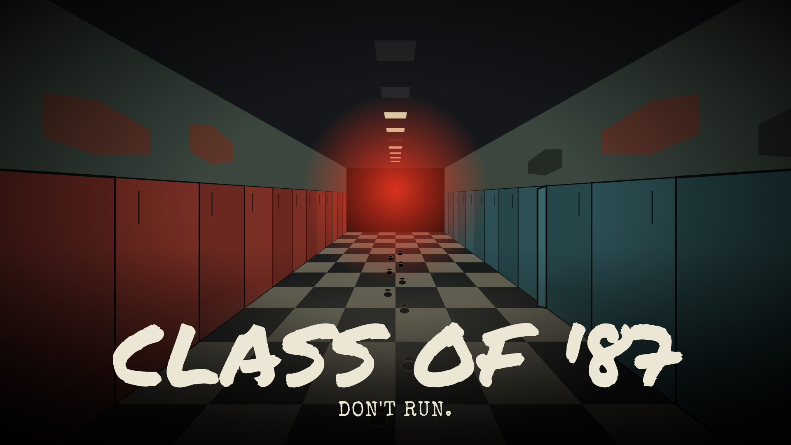
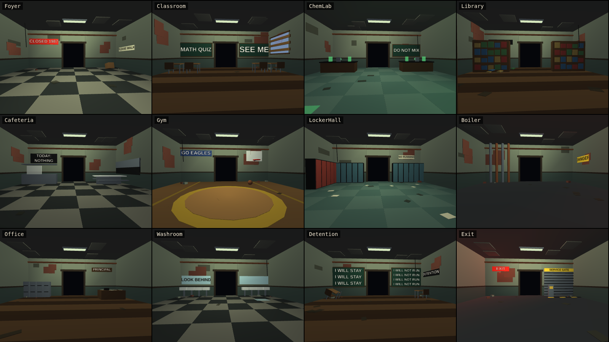

<p align="center">
  
</p>

<p align="center">
  <b>A co-op Roblox horror game set in an abandoned school.</b><br>
  Find 3 fuses, then get out, while something hunts you by sound.
</p>

<p align="center">
  
  
  
  
</p>

---

> **Work in progress.** The game is fully written and the logic tests pass, but it hasn't been played in Roblox yet. The first Studio playtest is next.

## The game

The school closed in 1987, after 31 students never left. The doors lock behind you.

- **Don't run.** Running is fast but loud. The threat hears it from 70 studs away, and walking from only 14. Standing still makes no sound at all.
- **Find 3 fuses.** Each one makes the threat faster and the scares come closer together.
- **The third fuse turns the lights red.** Now it hears every player, wherever they are. Run for the service gate.
- **Slam doors** to hold it back for 5 seconds, if you can afford the noise.

You never get a good look at it. You track it by its uneven footsteps, by dark footprints that fade behind it, and by lights that flicker as it gets closer. In a chase you might glimpse a headless robed figure.

Runs are short (aiming for 5 to 8 minutes) and shuffled every time.

## Rooms

Every run strings together a foyer, 7 rooms picked at random from 10 school room types, and an exit. Every room is built from code out of simple parts, with no imported models.

<p align="center">
  
</p>
<p align="center"><sub>Offline browser previews of all 12 rooms, rendered from the same room data. Roblox's lighting, fog and flashlight will look very different.</sub></p>

Four rooms have their own staged scene, played the first time you walk in:

| Room | What happens |
|---|---|
| Locker hall | Every locker bursts open in a wave racing toward you |
| Classroom and detention | The doors slam, the desks snap round to face you, and the board writes **SIT DOWN** |
| Washroom | Taps run, the stalls bang open, and the mirror writes **LOOK BEHIND** |
| First fuse | Blackout. Footsteps circle you in the dark, then the lights come back on and show the prints |

Between those, a director keeps up a steady stream of random scares: lockers, bursting lamps, chalk writing, falling tiles, sliding desks, door slams, static and racing footprints. It's never more than 15 seconds between scares, dropping to 3 to 5 seconds in the finale.

## Design rules

- **No music.** Only sound effects, and none that sound like music: no melodies, chimes, tonal drones or drum-like beats. Even the footsteps use uneven timing so they never fall into a rhythm.
- **No faces.** The threat only ever appears as a headless figure, and player avatars have their heads hidden.
- **Minimal reading.** No story line or sign is longer than 5 words, and you can move from the first second.

## How it's built

The code lives in this repo and is synced into Roblox Studio with [Rojo](https://rojo.space). The game logic that doesn't need Roblox is kept in pure modules, so it can be tested from the command line.

```
src/
├── shared/                 pure logic, tested outside Roblox
│   ├── LevelGen.luau       shuffled level layout and fuse placement
│   ├── Rooms.luau          every room as data: walls, props, signs, decay
│   ├── MonsterBrain.luau   patrol / investigate / chase decisions
│   ├── Pacing.luau         how often scares fire as tension rises
│   ├── SetPieces.luau      timing for the staged room scenes
│   ├── Story.luau          every line of story text
│   └── Config.luau         speeds, hearing ranges, level size
├── server/
│   ├── Main.server.luau    run flow, story beats, win and lose
│   ├── World.luau          builds the level in the world
│   ├── Monster.luau        movement, sight, hearing, footprints
│   ├── Director.luau       random and staged scares
│   └── Doors.luau          doors players can slam
└── client/
    └── Client.client.luau  lighting, flashlight, sprint, sound, HUD
```

The test suite generates 3,000 random levels and checks that rooms connect without repeats, fuses never land in the first or last room, and every run has a staged scene. It checks every room type for props that block a doorway and signs over 5 words. It also covers the threat's decision rules, scare timing, and that footsteps and locker bangs never settle into a beat.

## Run it

**Play in Studio:** build the place file (below), open `build/ClassOf87.rbxlx` in Roblox Studio, and press **F5**.

| Key | Action |
|---|---|
| WASD, mouse | Move and look |
| Left Shift (hold) | Run, loudly |
| F | Flashlight |
| E | Take, slam or open |

**Build and test** with [Rojo 7.7.1](https://github.com/rojo-rbx/rojo/releases) and the [Luau CLI](https://github.com/luau-lang/luau/releases):

```sh
luau tests/run.luau
rojo build default.project.json -o build/ClassOf87.rbxlx
```

**Regenerate the icon and thumbnail** (drawn with [Satori](https://github.com/vercel/satori)):

```sh
cd art && npm install && npm run build
```

## Docs

- [`docs/REQUIREMENTS.md`](docs/REQUIREMENTS.md): every requirement, and an honest status for each
- [`docs/ART.md`](docs/ART.md): how the art is made at no cost

*Class of '87 is a working title. The story is fiction.*
